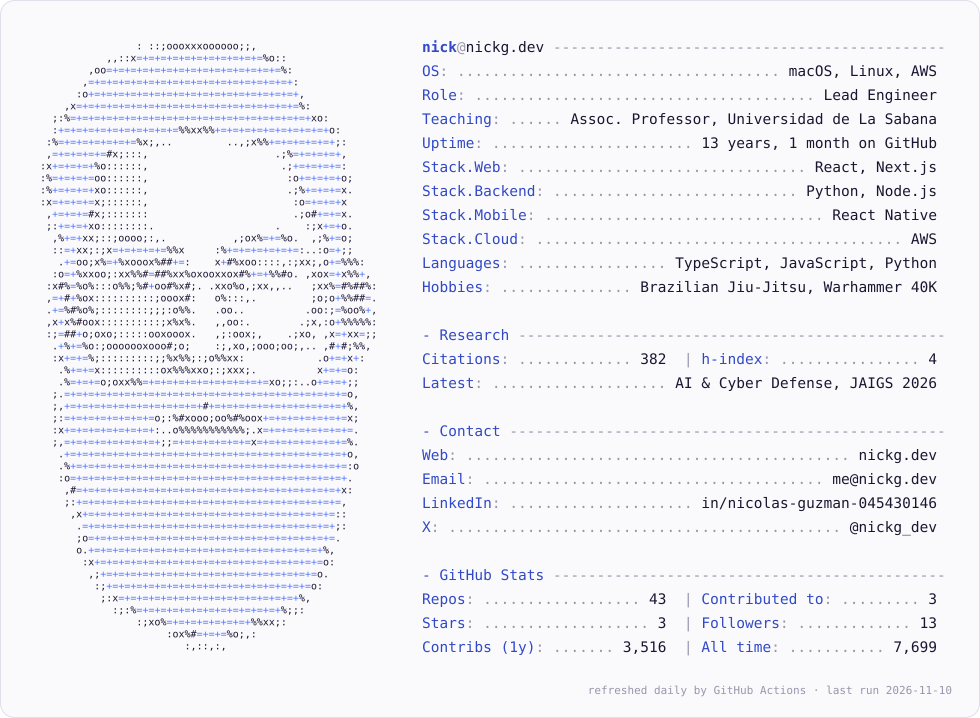

<a href="https://nickg.dev">
  <picture>
    <source media="(prefers-color-scheme: dark)" srcset="https://raw.githubusercontent.com/nicolasguzca/nicolasguzca/main/card_dark.svg">
    
  </picture>
</a>

  <a href="https://nickg.dev">nickg.dev</a> ·
  <a href="https://www.linkedin.com/in/nicolas-guzman-045430146/">LinkedIn</a> ·
  <a href="https://twitter.com/nickg_dev">X</a> ·
  <a href="https://scholar.google.com/citations?user=U73VCEUAAAAJ&hl=en">Google Scholar</a> ·
  <a href="https://www.researchgate.net/profile/Nicolas-Guzman">ResearchGate</a>

<picture>
  <source media="(prefers-color-scheme: dark)" srcset="https://raw.githubusercontent.com/nicolasguzca/nicolasguzca/main/swarm_dark.svg">
  
</picture>
